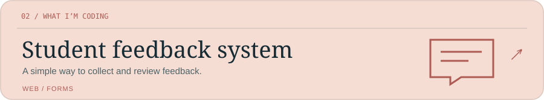

  

  <a href="https://portfolio-taupe-xi-haojutu7pj.vercel.app">Portfolio</a>
  &nbsp;·&nbsp;
  <a href="https://github.com/siddhi-joshi?tab=repositories">All repositories</a>

 

I turn small ideas into useful, approachable software. Right now I’m exploring **Java**, **Spring Boot**, **TypeScript**, and **React**—and learning by building.

### What I’m working on

  
  
  

### The work, in progress

### Selected projects

Building, learning, and sharing the process.

