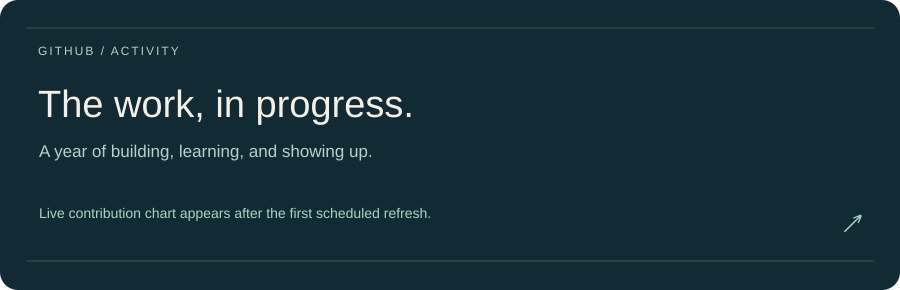

<!-- Animated, self-contained SVGs generated by scripts/render_cards.py. -->

 
 
 
 
<picture><source media="(prefers-color-scheme: dark)" srcset="./assets/title-coding-dark.svg" /></picture> 

<a href="https://portfolio-taupe-xi-haojutu7pj.vercel.app">portfolio</a> &nbsp;/&nbsp; <a href="https://github.com/siddhi-joshi?tab=repositories">repositories</a>

