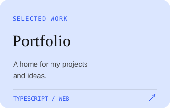

  

  <a href="https://github.com/siddhi-joshi?tab=repositories">Explore my work</a>
  &nbsp;·&nbsp;
  <a href="https://portfolio-taupe-xi-haojutu7pj.vercel.app">Visit my portfolio</a>

 

## Hello, I'm Siddhi 👋

I'm a software developer who enjoys turning ideas into useful, approachable applications. I'm currently learning more about **Java** and **Spring Boot** while building across the web.

### What I'm exploring

  
  
  
  
  

## Selected work

 

  Building, learning, and sharing the process — one project at a time.

